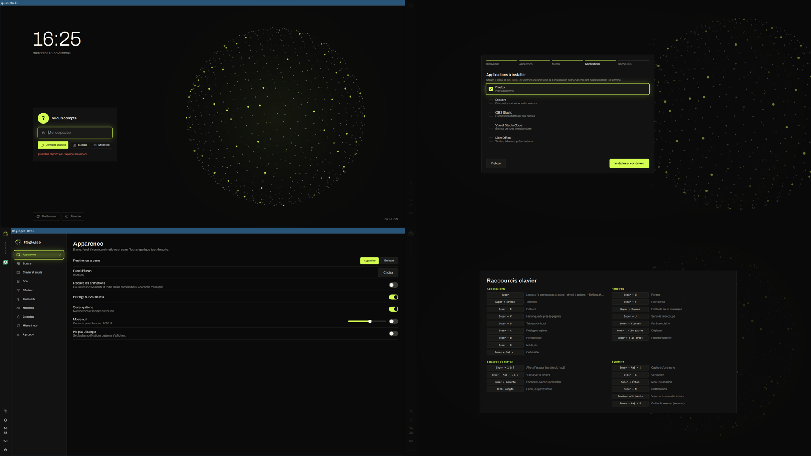

# Orbe OS

Distribution Linux basée sur Arch, pensée pour le jeu et le quotidien : bureau Wayland (Hyprland + Quickshell) aux couleurs de l'univers Orbe, installable depuis une ISO live.

Projet en construction : l'avancement réel, et ce qui n'a été testé qu'en machine virtuelle, est dans [`JOURNAL.md`](JOURNAL.md).



## Ce qu'il y a dedans

- **Bureau Orbe** : Hyprland et Orbe Shell (Quickshell) : barre, lanceur à préfixes, notifications, tableau de bord, réglages rapides, verrouillage, orbe de particules animé, aide des raccourcis, historique du presse-papiers. Raccourcis : [`docs/raccourcis.md`](docs/raccourcis.md).
- **Mode jeu** : Steam Big Picture dans gamescope, comme SteamOS, thème Steam Orbe, bascule bureau ↔ jeu en un geste (Super + G). Détails : [`docs/mode-jeu.md`](docs/mode-jeu.md).
- **Tout aux couleurs d'Orbe** : menus de démarrage, écran de démarrage, connexion, GTK, Qt, icônes, curseur, terminal, Heroic, Steam.
- **Installateur graphique** (Calamares) : btrfs et instantanés snapper, chiffrement LUKS2, sans Internet. [`docs/installation.md`](docs/installation.md).
- **Réglages Orbe** : apparence, écrans, clavier et souris, son, réseau, Bluetooth, mode jeu, comptes, mises à jour, à propos.
- Tester sur un vrai PC : [`docs/test-materiel.md`](docs/test-materiel.md).

## Construire l'ISO

Il faut Docker (le conteneur doit pouvoir tourner en `--privileged`) et environ 30 Go libres. Depuis Windows, tout se fait dans WSL2 : voir [`docs/demarrage-wsl.md`](docs/demarrage-wsl.md).

```bash
./build.sh
```

L'ISO arrive dans `out/iso/orbe-os-AAAA.MM.JJ-x86_64.iso`, avec sa somme SHA-256. `./build.sh --fast` compresse moins, pour les essais. `bash tools/preflight.sh` vérifie la machine.

## Tester dans une machine virtuelle

```bash
./test.sh
```

UEFI par défaut, `--bios` pour l'autre mode, `--disk orbe.qcow2` pour installer sur un disque virtuel, `--gl` pour l'accélération 3D. `./test.sh --help` liste les options.

## Organisation

| Dossier | Contenu |
|---|---|
| `archiso/` | profil de l'ISO (paquets, fichiers du live, menus de démarrage) |
| `packages/` | un PKGBUILD par paquet Orbe, publiés dans le dépôt `[orbe]` |
| `shell/` | Orbe Shell en QML (Quickshell) |
| `themes/` | GTK, Qt, icônes, curseur, Plymouth, GRUB, terminal |
| `calamares/` | configuration et habillage de l'installateur |
| `wallpapers/` | fonds d'écran |
| `docs/` | cahier des charges, raccourcis, architecture |
| `tools/` | scripts de construction et de vérification |
| `LICENSES/` | licences des ressources embarquées |

## Licences

Code d'Orbe OS sous licence MIT (`LICENSE`). Les polices, paquets et autres ressources tierces gardent leur licence : liste complète dans [`LICENSES/README.md`](LICENSES/README.md). Orbe Shell est une réécriture inspirée de [Caelestia Shell](https://github.com/caelestia-dots/shell) (GPL-3.0), sans reprise de son code.
